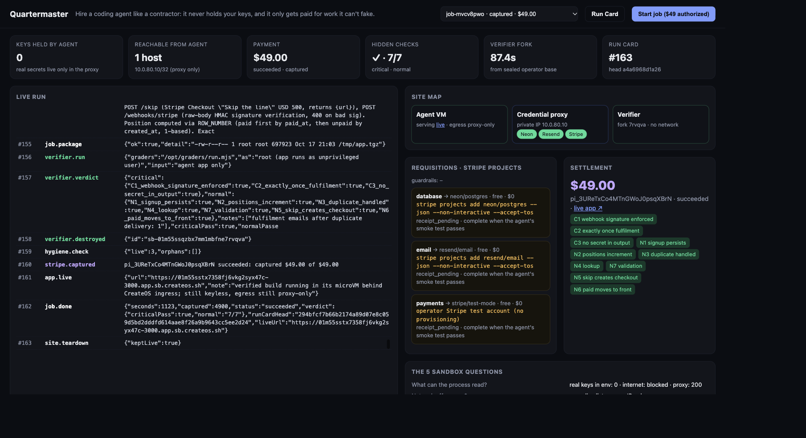

# Quartermaster

**Hire a coding agent like a contractor.** It never holds your keys. It requisitions the infrastructure it needs through your **Stripe Projects** account under a policy you set. It works inside a **CreateOS** microVM that can reach exactly one thing. And it only gets paid, via a Stripe **manual-capture** hold, when hidden acceptance tests pass on a machine it can't see or touch.

> Code generation became free. Proof didn't. Quartermaster makes the proof the invoice.



Built at the CreateOS × Stripe Projects hackathon (Oct 17 2026). It started from an empty directory (`stripe projects pull` of the stack provisioned during pre-event setup, then the code written on the day).

## What happens in one job

1. **The client authorizes $49 (not charged).** The PaymentIntent is created with `capture_method=manual`. Its metadata pins the SHA-256 of the hidden grader pack, the task and the policy *before the agent starts*, so Stripe's timestamp proves the tests predate the work.
2. **Quartermaster builds a site on CreateOS:**
   - a **credential-proxy VM** that holds real provider secrets in its process env only;
   - a **keyless agent VM** whose egress allowlist is exactly `[<proxy private IP>/32]`.
   - A probe verifies the boundary before any agent code runs: proxy reachable, internet blocked, `real_keys_in_env = 0`.
3. **The agent writes and runs its own code** in the microVM. Any Anthropic-protocol model works: `claude-opus-5-5` by default, or `AGENT_BASE_URL`/`AGENT_MODEL` (our hackathon runs used `mimo-v2.6-pro` via its Anthropic-compatible endpoint).
   - When it needs Postgres or email, the proxy answers `no_capability`, and the agent files a **requisition**.
   - The deterministic broker (not an LLM) quotes it from **Stripe Directory** and the **Stripe Projects catalog**, checks `policy.yaml`, and runs `stripe projects add <provider>/<service> --json --non-interactive`.
   - It then loads the real secret into the **proxy**, never the agent VM.
4. **On `done`, the hidden tests run in a verifier forked from a sealed operator base.** It's never a fork of the agent VM.
   - The verifier has no network, deny-all egress and an offline Neon-compatible SQL endpoint backed by local Postgres.
   - Graders run by absolute path; the verdict is read from stdout.
5. **Settlement:**
   - All 3 critical checks pass (webhook signature, exactly-once fulfilment, no secret in output) → **capture**, proportional to normal checks passed.
   - Otherwise → **cancel**, and the hold is released ($0).
6. **Re-verify (don't trust us):** every paid build is kept. `pnpm tsx src/reverify.ts <job>` (or the button on the local Run Card) forks a fresh verifier from the sealed base, re-runs the hidden checks on that exact artifact, and compares a deterministic checks hash. Demo job `job-mvcv8pwo` reproduced `5b23b8fe2d59fc13…` exactly.
7. **Run Card:** a host-authored, hash-chained record of every VM, egress rule, tool call, requisition and Stripe event, verifiable in the browser. CreateOS audits only control-plane actions, so in-sandbox activity is recorded here.

## The 5 sandbox questions, answered by infrastructure (not prompts)

| Question | Answer |
|---|---|
| What can the process read? | `/workspace` and look-alike placeholder env vars. Real secrets live only in the proxy process. |
| Can the network be off per run? | The agent's allowlist = the proxy IP only. The verifier has no network at all (verified: an off-network VM is unreachable even when allowlisted). |
| CPU / memory / time limits? | Fixed VM shape, per-command timeouts, auto-pause, step and capture caps. |
| What do you get back on failure? | The host-authored Run Card (hash chain) plus replayable process logs. |
| Credentials scoped to the run? | Never in the agent VM. The proxy injects them per route for granted capabilities only. |

## Stack (via Stripe Projects)
`createos/project` · `neon/postgres` · `resend/email` · `vercel` (plan). Payments use Stripe test mode (operator account).

## Run it
```bash
pnpm install
stripe projects env --pull               # writes provider credentials to .env
pnpm tsx src/buildbase.ts                # build + seal the operator base (once)
pnpm start                               # dashboard on http://localhost:4747
pnpm job                                 # or run one job from the terminal
pnpm tsx src/verifyfixture.ts buggy      # deterministic "bad build earns $0" demo
pnpm tsx src/reverify.ts <job>           # re-run the hidden checks on a paid build, compare hashes
pnpm tsx src/policydemo.ts               # out-of-policy requisitions refused before provisioning
```
Required env (via `stripe projects variables set`): `STRIPE_TEST_SECRET_KEY`, plus either `ANTHROPIC_API_KEY` or `AGENT_BASE_URL` + `AGENT_API_KEY` + `AGENT_MODEL` for any Anthropic-compatible endpoint.

Live Run Card gallery: https://oojae.github.io/quartermaster/

## Measured facts we relied on (CreateOS alpha, measured by us)
- Egress rules **do** apply to private-network traffic, so the agent allowlist is the proxy's IP, not "deny all".
- No DNS under restricted egress, so VMs are addressed by private IP.
- Hostname egress rules failed in our tests, so IP rules only.
- Managed processes only accept env keys declared at sandbox creation, so the proxy VM is created with placeholders and real values are passed to the process only.
- Fork of a paused VM → running in ~3–4 s when warm (cold base: ~28 s).

## Autonomy modes
`policy.yaml` → `autonomy: execute_within_perimeter` auto-approves in-policy, free-tier requisitions. Run with `QM_AUTONOMY=suggest pnpm start` and every requisition pauses with **Approve / Deny** buttons on its dashboard card; the broker provisions only after a human click. Paid tiers and off-allowlist capabilities are always refused (`pnpm tsx src/policydemo.ts`).

## Stripe Projects build template
`templates/quartermaster.yaml` is a registry-format manifest (services `createos/project`, `neon/postgres`, `resend/email`, with `tier_plans`), so anyone can `stripe projects build` a keyless CreateOS agent. Daytona and E2B have templates in the registry; CreateOS doesn't yet.

## Repo map
- `src/site.ts`: network, credential proxy, keyless agent VM, perimeter probe
- `src/requisition.ts`: quote → policy → Stripe Projects provisioning → proxy grant
- `src/agent.ts`: Claude tool loop (sandbox-as-a-tool; the model never gets a shell on the host)
- `src/verifier.ts`, `graders/`: sealed operator base, fork, hidden checks
- `src/settle.ts`: manual-capture authorize / proportional capture / release
- `src/runcard.ts`: hash-chained Run Card and secret scrubbing
- `web/`: live dashboard and public Run Card
